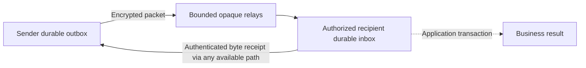

# Architecture

PechPech (پچ‌پچ, whispering) extracts the general communication mechanism developed for GARVI into a separate open-source package. Release 0.3 keeps the generic node's version-2 protocol/storage namespace introduced in 0.2 and adds routing for host-managed encrypted profiles. A host's envelope and business receipts remain distinct from the generic protocol. The prior 0.1 SDK release has incompatible APIs, wire identifiers and storage; see [migration](migration-0.2.md).

## Layers

| Layer | Owns | Does not establish |
| --- | --- | --- |
| `PechPechCore` | Generic encrypted packets and durable byte receipts, plus routing/authenticated neighbor sessions for host-managed opaque profiles | Trust enrollment or business acceptance |
| `PechPechApple` | Foreground BLE and TCP/Bonjour links, discovery, fragmentation, per-link queues, disconnection events and an optional host-scoped Keychain identity helper | Application permissions or durable endpoint delivery |
| Host application | Secure key storage, trusted recipient selection, sender authorization, payload schema, UI, lifecycle and business transactions | A guarantee that radios or intermediate devices will remain available |

`PacketLink` connects the routing core to a transport. Link-local peer identifiers are temporary transport handles, not endpoint identities. Signed identity exchange binds a handle to a cryptographic peer; applications still need an independent trust policy.

This diagram describes `MeshNode`. Its receipt arrow resolves communication delivery; the separate application transaction decides whether a business action succeeds. `OpaquePacketRouter` instead uses the host's existing encrypted envelope and durable hooks, without adopting `MeshStore` or its generic endpoint receipt. See [opaque profiles](opaque-profiles.md).

## Durable state

`MeshStore` keeps owned outgoing messages and received inbox bytes separate from the spool for other devices' encrypted packets. A full relay spool cannot evict an application's unresolved outgoing message or turn an endpoint receipt into a business result.

The store enables and verifies SQLite WAL mode with `synchronous=FULL`; mutations use `BEGIN IMMEDIATE` transactions. `bindIdentity(_:)` pins one endpoint address to a database, including after restart. Reusing that store with another identity fails. Queueing records the exact message, recipient public identity and priority. Changing any of those for an existing outgoing ID fails.

Current tables use the `pechpech_` namespace. The store rejects unrecognized user tables, unexpected views/triggers/custom indexes and incompatible table definitions/columns before enabling WAL or creating its tables. New table creation is transactional. Use a dedicated SDK database file; do not point the new store at a prior-release or unrelated application database and expect automatic migration.

The recipient records the inbox result and its outgoing endpoint receipt transactionally. Repeated messages with the same identity and contents recover the same result. A conflicting reuse of an identity is rejected. The sender persists a matching authenticated receipt before reporting durable endpoint delivery. Lost receipts can return through a different route; intermediate relay acknowledgments cannot substitute for them.

Inbox and outbox history is retained for deduplication and recovery; the first release does not automatically compact it or impose the relay spool's capacity on it. A successfully stored receipt removes an outgoing message from the pending query without deleting the original snapshot. Receipt acknowledgment retires an active return packet while keeping the durable received message/result. Applications need an explicit, reviewed retention policy and storage monitoring before long-running deployment.

Applications that perform actions need a second durable boundary. For example, receiving bytes for a stock adjustment is distinct from validating permission and committing that adjustment. Store application effects and their own idempotent result atomically in application-owned storage. GARVI's prepare/grant/commit and kitchen receipt semantics belong at this layer, not in a generic radio transport.

## Routing and backpressure

Packets carry an explicit destination and bounded hop budget. The routing node can use available neighbors and store-and-forward encrypted packets without learning their payload. There is no elected leader, automatic authority promotion or replicated business database.

The first defaults are four distinct authenticated neighbor identities per node and up to four neighbor links per native adapter, eight hops, 16 KiB encoded relay packets, and a relay spool of 512 packets / 8 MiB with a 128-packet claimed-origin allowance. Endpoint payloads initially have a 4 KiB limit. See [protocol](protocol.md) for exact encoding and admission rules.

Relay admission prunes expired traffic. A higher-priority packet may replace lower-priority traffic, including within its claimed origin's allowance; equal/higher-priority packets are not displaced. Admission and any evictions are one transaction, so a failed admission restores the previous copies. A duplicate packet ID requires identical authenticated header and ciphertext; its saved remaining-hop count can decrease but never replenish. Relay storage acknowledgment is not a promise of indefinite retention or endpoint arrival.

Transport queues are smaller, transient buffers. Successful local enqueue, a completed socket write, BLE write response, relay storage and durable endpoint receipt are separate events. Hosts must retain pending work and expose missing paths instead of treating any of the earlier events as completion.

## Deployment scope

The package currently targets Swift 5.9, iOS 16 and macOS 13 or later. Apple adapters require native APIs and user-granted permissions. There is no Android, Linux or browser adapter in this release. The versioned protocol documentation is intended to support future independent implementations.

Foreground nearby operation is the initial scope. Locking a device, closing an app or moving a relay out of range can interrupt a route. Core tests and injected-link demos do not qualify native radio performance. See [qualification](qualification.md).

## Host adoption boundaries

Adopting either integration requires preserved command identity, pinned endpoints, durable stores, explicit lifecycle intent and application-specific tests. GARVI's prepare/grant/commit, order status and durable kitchen receipt remain host responsibilities when its original envelope is carried through an opaque profile. Installing this generic SDK repository alone does not migrate an application or prove its behavior on physical devices.
